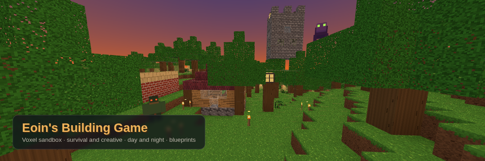

# Eoin's Building Game

A first-person voxel building sandbox that runs entirely in the browser. Wander procedurally generated hills, forests and lakes, dig and build with twenty-one kinds of block, stamp whole structures from a blueprint library, and watch the sun set over your work. Play in **Creative** for unlimited building, or in **Survival**, where you gather materials, craft tools, keep yourself fed and defend your camp from the creatures that come out at night. Everything you see and hear is generated in code: there are no image or audio files in this repository.

**Play it:** https://eoinfitzsimons.github.io/Eoin-s-Building-Game/



## How to play

Choose **Creative** or **Survival** on the start menu, click **New world** (or **Continue saved world** if you have one), then click the game to capture the mouse pointer.

| Action | Control |
| --- | --- |
| Move | `W` `A` `S` `D` |
| Jump | `Space` |
| Sprint | hold `Shift` |
| Toggle flying (Creative) | `F` (hold `Space` to rise, `Shift` to descend) |
| Look | move the mouse |
| Place the selected block | left click |
| Break a block | right click (Creative: instant · Survival: hold to mine) |
| Pick the block you are looking at | middle click |
| Choose a block or item | mouse wheel or keys `1` to `9` |
| Show the next page of the hotbar | `Tab` |
| Open or close blueprint mode (Creative) | `B` |
| Choose a blueprint | mouse wheel or `[` and `]` |
| Rotate the blueprint | `R` |
| Stamp the blueprint | left click (in blueprint mode) |
| Eat the held food or attack with the held tool (Survival) | left click |
| Open or close the crafting panel (Survival) | `C` |
| Skip time to dusk or dawn | `N` |
| Mute or unmute sound | `M` |
| Hide or show the control hints | `H` |
| Pause menu | `Esc` |

A full day lasts four minutes; the clock in the top-left corner shows the sun and moon travelling across their arc so you can see dusk coming. The world saves itself automatically every half minute and whenever you pause or leave the page.

### Survival

- **Health and hunger** are shown as hearts and drumsticks above the hotbar. Hunger falls over time (faster while sprinting or swimming); once it is empty your health drains, and while you are well fed your health slowly recovers. Apples drop from oak leaves, berries grow on bushes in the grasslands, and creatures drop raw meat that can be cooked.
- **Mining takes time.** Hold right click to break a block; a ring around the crosshair shows your progress. Dirt, sand and gravel come up quickly, wood wants an axe, and stone, bricks and ore need a pickaxe to collect at all. Iron ore needs a stone pickaxe or better.
- **Tools** come in wooden, stone and iron tiers (pickaxe, axe, shovel and sword), each with a durability bar in the hotbar. Better tiers mine faster and hit harder.
- **Crafting** (`C`) turns what you have gathered into planks, torches, glass, stone bricks, lanterns, cooked meat and tools. Recipes you cannot afford yet are greyed out, with the missing ingredients highlighted.
- **Night creatures** appear on the dark surface once the sun goes down: slow, heavy **brutes** that walk straight at you and hit hard, and quick **lungers** that stalk, crouch and pounce. Both avoid torch-lit ground, burn away at sunrise, and drop meat, cobblestone or berries when defeated. A held torch lights your surroundings.
- **Death** shows a game-over panel with a respawn option. Your world and your inventory are kept; you wake at the starting point in daylight.
- Survival state (inventory, health, hunger, deaths and the time of day) is saved and loaded with the world, and travels with JSON exports.

You start a Survival world with a wooden axe, four torches and three apples.

## Features

- **Procedural terrain** – a seeded world of rolling hills, stone peaks capped with snow, sandy shores, gravel beds, oak forests and still water. Type any word into the seed box to get a different landscape; the same seed always produces the same world.
- **Twenty-one blocks with hand-drawn textures** – grass, dirt, stone, cobblestone, stone bricks, mossy stone, sand, sandstone, gravel, snow, oak logs, leaves, planks, brick, roof tiles, glass, lanterns, water, torches, iron ore and berry bushes. Every texture is painted onto a canvas at start-up, so the game ships with no image files.
- **Day and night cycle** – a four-minute day with a gradient sky dome that runs from deep night through an orange dawn, blue noon and red dusk; the sun, moon and stars track across the sky, the fog and lighting follow the sky colours, and a HUD clock shows the sun and moon on their arc.
- **Two modes** – Creative gives every block, flying and blueprints; Survival adds health, hunger, timed mining, tools with durability, crafting, food, night creatures, death and respawn.
- **Blueprint mode** – a creative tool that places a translucent preview of a prebuilt structure where you are looking and stamps it into the world with one click. Nine blueprints are included: a cottage, a watchtower, a bridge, a well, an oak tree, a stone arch, a garden wall, a lamp post and a pond. Blueprints can be rotated in quarter turns.
- **Save, load, export and import** – your world is saved to `localStorage` as a seed plus the list of blocks you have changed, so even large builds stay small. The pause menu can export the world as a JSON file and import one back, which makes it easy to share builds or move them between browsers.
- **Synthesised sound** – place and break clicks tuned to the material (wooden knocks, stony thuds, glassy chimes), soft footsteps, menu clicks and an ambient wind bed that grows stronger as you climb. All of it is generated with the Web Audio API; there are no audio files. `M` mutes everything and the preference is remembered.
- **Smooth performance** – the world is split into 16 × 16 × 64 chunks that are meshed on demand with hidden faces culled and simple ambient occlusion baked into the vertex colours. Only chunks within the render distance (adjustable from the pause menu) are built, and editing a block rebuilds just the chunk it belongs to.
- **Start and pause menus** – a start screen with the controls, seed entry and a summary of your saved world, plus a pause menu with save, export, import, sound and render-distance options.

## Running locally

The game is a static site with no build step. It uses ES modules, so it needs to be served over HTTP rather than opened from the file system:

```bash
git clone https://github.com/EoinFitzsimons/Eoin-s-Building-Game.git
cd Eoin-s-Building-Game
python3 -m http.server 8000
```

Then open http://localhost:8000/ in a modern browser (Chrome, Edge, Firefox or Safari). Three.js is loaded from the jsDelivr CDN, so an internet connection is required the first time.

Handy URL parameters for testing: `?seed=<word>` skips the menu and starts a new world straight away, `&mode=survival` starts it in Survival, and `?thumbnail` hides the HUD for taking screenshots.

## Technical notes

| File | Purpose |
| --- | --- |
| `index.html` | Page structure: canvas, HUD, hotbar, blueprint panel, start and pause menus. |
| `style.css` | All styling, including the menus and the responsive hotbar. |
| `game.js` | Game controller: Three.js scene, player physics, input, targeting, building, blueprints, day/night sky, saving and the menus. |
| `js/world.js` | Seeded value-noise terrain, chunk storage, sparse edit tracking, greedy-free face meshing with ambient occlusion, and a voxel raycaster. |
| `js/blocks.js` | Block definitions and the procedural texture painters that build the 32 px texture atlas on a canvas at start-up. |
| `js/blueprints.js` | Structure definitions written as text layers, with rotation support. |
| `js/items.js` | Survival items: inventory stacks, tool tiers, food, block drops, break times and crafting recipes, plus the pixel-art item icons. |
| `js/enemies.js` | Night creatures: box-built meshes, movement and collision, brute and lunger behaviour, hit detection and drops. |
| `js/audio.js` | Web Audio synthesiser for clicks, footsteps, wind and the Survival sounds (mining ticks, hits, growls, eating, crafting). |

- **Rendering** – Three.js (0.154) with a single `MeshLambertMaterial` atlas for opaque blocks, a separate transparent pass for glass, leaves and water, and an emissive pass for lanterns. Chunk meshes are rebuilt through a small queue so that generation never blocks a frame for long.
- **Terrain** – fractal Brownian motion over a hashed value-noise function gives continents, hills and ridges; a second noise layer picks biomes (sand near the water line, gravel in low ground, snow on peaks) and a hashed per-column check plants trees on open grass.
- **Terrain extras** – iron ore is scattered through the stone in small hashed clusters, and berry bushes are planted on open grass away from trees.
- **Persistence** – saves are `{ version, seed, mode, time, player, survival, edits: [[x, y, z, blockId], ...] }`, where `survival` holds health, hunger, kills, deaths and the inventory (or `null` in Creative). The same shape is used for the JSON export, so an exported file can be imported anywhere; older saves without a mode load as Creative.
- **Creatures** – enemies share the player's axis-by-axis collision approach, hop up single blocks, and are updated only while playing in Survival. Spawning happens on dark surface blocks 14–30 blocks from the player and is skipped near any glowing block.
- **No dependencies beyond Three.js** – there is no bundler, package manager or framework; the repository can be served as-is from GitHub Pages.

## Licence

MIT – see [LICENSE](LICENSE).
